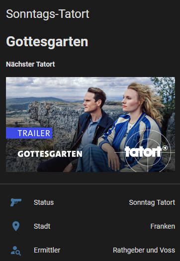

# Tatort für Home Assistant

Eine kleine Custom Integration für HACS, die die bisherige Tatort-REST-Konfiguration als Integration in Home Assistant bereitstellt.

## Entitäten

- `sensor.tatort_aktuell` – `Sonntag Tatort` oder `Sonntag kein Tatort`
- `sensor.tatort_hinweis` – `Letzter Tatort` oder `Nächster Tatort`, anhand des ARD-Ausstrahlungsdatums des hervorgehobenen Beitrags
- `sensor.tatort_stadt`
- `sensor.tatort_titel`
- `sensor.tatort_ermittler`
- `sensor.tatort_folgen_id`
- `sensor.tatort_bild_api` – Bild-URL für die bestehende Lovelace-Karte

Die Integration ruft die Tatort-Seite und – sofern eine Folgen-ID gefunden wurde – die zugehörigen ARD-Mediathek-Metadaten alle sechs Stunden ab. Der Hinweis `Nächster Tatort` erscheint, wenn das ARD-Ausstrahlungsdatum des hervorgehobenen Beitrags heute oder in der Zukunft liegt; andernfalls lautet er `Letzter Tatort`. Falls die ARD kein Ausstrahlungsdatum liefert, wird vorsichtshalber `Letzter Tatort` angezeigt. Die ARD-Mediathek-API ist nicht als öffentliche, stabile API zugesichert. Änderungen an der ARD-Seite oder API können Anpassungen erforderlich machen.

## Installation zum Testen

1. Den Ordner `custom_components/tatort` nach `/config/custom_components/tatort` kopieren.
2. Home Assistant neu starten.
3. Unter **Einstellungen → Geräte & Dienste → Integration hinzufügen** nach **Tatort** suchen.

Repository: [TheBrain26/ha-tatort](https://github.com/TheBrain26/ha-tatort).

In HACS unter **⋮ → Benutzerdefinierte Repositories** die Adresse `https://github.com/TheBrain26/ha-tatort` mit dem Typ **Integration** hinzufügen. Danach in HACS nach **Tatort** suchen und installieren. Das Repository muss öffentlich sein, damit HACS darauf zugreifen kann. 

### Lovelace-Karte mit Bildvorschau

#### Vorschau

Unter [examples/tatort_dashboard.yaml](examples/tatort_dashboard.yaml) liegen die Markdown-Vorschau und deine Entitätenkarte in einem gemeinsamen Kartenrahmen. Beide Karteninhalte bleiben erhalten; die Trennfuge dazwischen entfällt. Dafür wird die Lovelace-Karte **Stack In Card** benötigt (Home Assistant 2025.1 oder neuer). Das Beispiel enthält auch den Hinweis `sensor.tatort_hinweis`. In einem bereits bestehenden Dashboard muss diese Entität bei Bedarf manuell ergänzt werden.

1. In HACS unter **Frontend → ⋮ → Benutzerdefinierte Repositories** `https://github.com/duczz/ha-stack-in-card` als **Lovelace** hinzufügen und **Stack In Card** installieren.
2. Ein Dashboard bearbeiten, **Karte hinzufügen → Manuell** auswählen und den Inhalt der YAML-Datei einfügen.
3. Falls Home Assistant die Sensoren wegen bereits vorhandener YAML-Entitäten mit abweichenden Entity-IDs angelegt hat, die IDs in der Karte entsprechend anpassen.

### Alternative: Kompakte Lovelace-Karte

Die zweite Variante zeigt das Vorschaubild links und Titel, Ort sowie Ermittler mit farbigen Symbolen direkt daneben. Beim Antippen öffnet sich die Bildvorschau als Popup.

Die vollständige Konfiguration steht unter [examples/tatort_dashboard_compact.yaml](examples/tatort_dashboard_compact.yaml). Auch diese Karte zeigt `sensor.tatort_hinweis`; in einer bestehenden Karte muss die Entität bei Bedarf manuell ergänzt werden.

**Voraussetzungen:** Die HACS-Frontend-Erweiterungen [Button Card](https://github.com/custom-cards/button-card) und [Browser Mod](https://github.com/thomasloven/hass-browser_mod) müssen installiert sein.

Ein Dashboard bearbeiten, **Karte hinzufügen → Manuell** wählen und die YAML-Datei einfügen.

### Integrations-Icon

Das eigene Icon liegt unter `custom_components/tatort/brand/` und wird von Home Assistant 2026.3 oder neuer direkt aus der Integration geladen. HACS kann in seiner Repository-Liste bis zu einer HACS-Korrektur weiterhin den Platzhalter zeigen ([offener HACS-Fehler](https://github.com/hacs/integration/issues/5171)).

## Migration der bestehenden YAML-Sensoren

Zuerst die Integration testweise hinzufügen und die erzeugten Entity-IDs prüfen. Danach die bisherigen Tatort-REST-Sensoren aus der YAML-Konfiguration entfernen, damit keine doppelten Entitäten entstehen. Die Sensor-Namen und eindeutigen Kennungen entsprechen der bisherigen Konfiguration; Home Assistant kann bei schon registrierten REST-Entitäten dennoch Entity-IDs anpassen. Falls nötig, die Entity-IDs in **Einstellungen → Geräte & Dienste → Entitäten** angleichen, damit vorhandene Lovelace-Karten unverändert weiterlaufen.

## Entwicklung

Die HTML- und JSON-Auswertung ist in `custom_components/tatort/parser.py` von Home Assistant entkoppelt und kann mit den Tests unter `tests/` geprüft werden.
